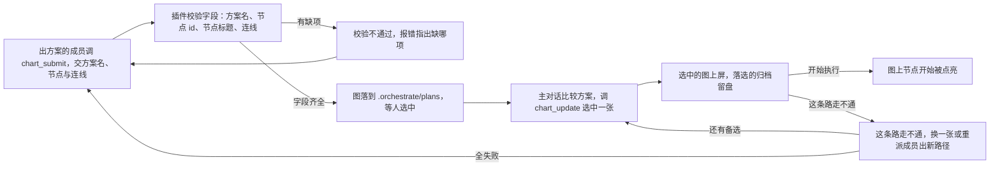

# 方案图

从成员调用 chart_submit 交方案图到主对话选中、落选归档

## 简报

### 目标
每个方案都有一张流程图，主对话选中的那张成为面板上执行的图。

### 要做什么
- 成员调 chart_submit 交方案：方案名、节点（id、标题）、连线。
- 插件只校验字段齐全，不查节点数量、不查是否唯一入口、不查是否有环。
- 校验失败的报错要点名缺哪项，成员改完重交。
- 候选图落在 .orchestrate/plans 下；主对话调 chart_update 选中一张，选中的上屏，其余归档留盘。
- 一条路走不通时，主对话可以换一张，或重派成员出新路径。

### 验收
- 少字段的 chart_submit 被拒，报错点名该字段。
- 选中后 state.json 里的选中图 id 跟着变，面板显示的是新的那张。
- 落选方案仍能在 .orchestrate/plans 下找到。
