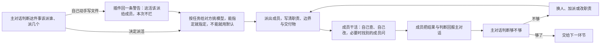

# 派活

从主对话决定分工到成员的结算消息回到主对话

## 简报

### 目标
一件活能被派给具体成员，成员干完把结论交回主对话。

### 要做什么
- 主对话判断派谁、派几个，写清职责、边界与交付物再派。
- 成员干活时可以直接改项目文件，也可以找别的成员问。
- 成员有结果就回报主对话；主对话判断不够就换人、加派、改职责重派。
- 主对话自己调写文件类工具时，插件回一条警告：这活该派给成员，本次不拦；调用照常执行。
- 提示词不规定必须先调研或必须先出方案，顺序由主对话决定。

### 验收
- 一次真实派活里能看到 spawn_teammate 调用与成员的结算消息。
- 主对话在模式里调一次 write，能收到那条警告，且写入仍然发生。
- 团队工具缺席时同样的活走 subagent，主对话代为转达。

### 约束
- 不引入插件自己的派活工具，一律用宿主的。
- 警告只发给主对话，成员正常写文件不挨警告。
