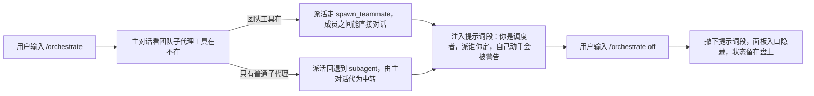

# 进入与回退

从用户敲 /orchestrate 到提示词段生效、团队缺席时回退、/orchestrate off 撤下

## 简报

### 目标
敲 /orchestrate 之后提示词段生效，团队子代理没开也能派活。

### 要做什么
- 命令 /orchestrate 开启，/orchestrate off 关闭；关闭后撤下提示词段、隐藏面板入口、保留盘上状态。
- 开启时检查团队子代理工具：在就用 spawn_teammate，成员之间能直接对话；不在就回退到 subagent。
- 注入的提示词段写明主对话的职能（路由模型与调度）、别自己动手改东西、动手会收到警告、派谁由它判断。
- 能指定模型时按任务给成员挑 provider 与 model，不能就用默认。

### 验收
- 敲 /orchestrate 回执为开启，下一条回复里主对话按调度者行事。
- 敲 /orchestrate off 后，提示词段不再出现在系统提示词里，面板入口消失。
- 团队工具缺席时开启不报错，回执里说明回退到普通子代理。

### 约束
- 模式是会话级，由用户主动开关，不常驻。
