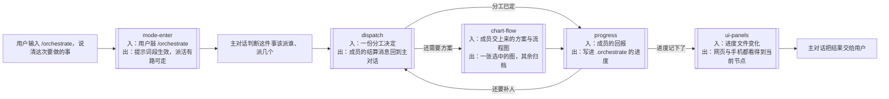

# 编排全貌

从用户输入 /orchestrate 到图上节点全部点亮、结果交给用户

## 简报

### 目标
/orchestrate 开启后，一件事从需求进来就被拆给成员做完，当前走到哪在图上看得到。

### 要做什么
- 主对话只做两件事：路由模型与调度。派谁、派几个、要不要审查，由主对话按场景决定，不写死流程。
- 派活走宿主的 spawn_teammate；团队子代理没开时回退到 subagent，由主对话中转。
- 出方案的成员交流程图，主对话选中一张，之后只负责点亮节点。
- 进度落在项目根的 .orchestrate 下，网页与手机两处面板都能看。

### 验收
- 跑一次真实小任务，全链条走通：派成员、出方案图、选中、点亮、两边面板可见。
- .orchestrate/state.json 存在，且含选中图、阶段、下一步、成员清单。

### 约束
- 主对话不自己动手改东西：提示词写明，代码不拦，调写文件工具时插件回一条警告。
- 旧计划机制（plan_submit、校验器、.method/plan.md、68 项自测）全删。
