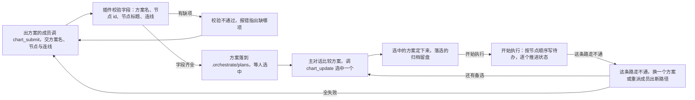

# 方案

从成员调 chart_submit 交方案到主对话选中、落选归档

## 简报

### 目标
成员交的每个方案都是一串有序步骤，主对话选中的那个就是这轮照着走、照着写待办的那条路径。

### 要做什么
- 成员调 chart_submit 交方案：方案名、节点（id、标题）、连线。
- 插件只校验字段齐全，不查节点数量、不查是否唯一入口、不查是否有环。
- 校验失败的报错要点名缺哪项，成员改完重交。
- 候选方案落在 .orchestrate/plans 下；主对话调 chart_update 选中一个，其余归档留盘。
- 执行中才发现一条路走不通，主对话换一个方案，或重派成员出新路径。

### 验收
- 少字段的 chart_submit 被拒，报错点名该字段。
- 选中后 state.json 里的 selectedChart 跟着变，提示词与待办换成新的那个方案。
- 落选方案仍能在 .orchestrate/plans 下找到。
