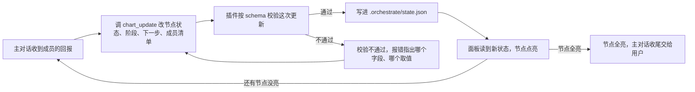

# 点亮与存档

从主对话收到回报到写进 .orchestrate/state.json

## 简报

### 目标
主对话每次更新都写进状态文件，面板上看到的就是最新的。

### 要做什么
- chart_update 一次能改四类东西：节点状态、阶段一句话、下一步、成员清单。
- 节点状态只有四种：待办、进行中、完成、失败。
- 内容按 schema 校验，缺字段或取值非法就报错，点名哪个字段哪个取值。
- 校验通过写进 .orchestrate/state.json，按项目目录存，同项目多会话共用一份。
- 状态只能通过工具写，没有别的写入途径。

### 验收
- 传非法状态值被拒并点名。
- 更新后 state.json 内容与面板显示一致。
- 同一项目另开一个会话，面板看到的是同一份进度。
