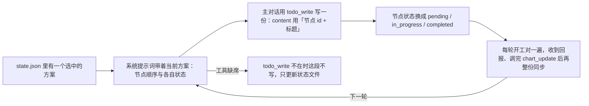

# 待办同步

从选中的方案到对话里与之一致的待办

## 简报

### 目标
对话里的待办就是那个方案：顺序一致、状态一致，不用回头翻状态文件。

### 要做什么
- 提示词每轮带上当前方案：方案名与完成计数、阶段、下一步、按连线顺序的节点与状态、成员。
- 待办工具在时，提示词要求主对话把节点写成 todo：content 写「节点 id + 空格 + 标题」，status 只取 pending / in_progress / completed。
- 状态映射：完成 → completed，进行中 → in_progress，待办和失败 → pending。
- todo_write 是整份替换，每次给全量；每轮开工对一遍，chart_update 之后再对一遍。
- 没有选中方案时，提示词不写那一段，也不要求写待办。

### 验收
- 开模式并选中一个方案后，主对话写出与方案同序同状态的待办。
- 节点标题重名时，待办不会被工具拒（content 带上了 id）。
- 改一个节点状态后，下一轮待办跟着变。
- 没有 todo_write 的环境里，提示词不出现待办那一段。

### 约束
- 待办只是把状态文件抄一份，写权在状态文件；chart_update 才是进度的唯一来源。
