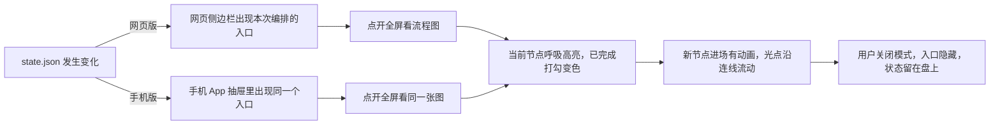

# 进度面板

从 state.json 变化到网页与手机两处入口显示当前节点

## 简报

### 目标
侧边栏有个入口，点开能看到当前编排的完整流程图。

### 要做什么
- 网页版由 Cordis 插件的客户端部分渲染，手机版是 dsh-go 原生小插件，两边读同一份 state.json。
- 入口只在模式开启时出现；点开全屏看图，图上方一行阶段、下面一行下一步，另有成员清单。
- 当前节点呼吸高亮，已完成节点打勾变色，新节点进场有动画，光点沿连线流动。
- 模式关闭后入口隐藏，状态文件保留。

### 验收
- 改一次 state.json，网页侧边栏入口出现且能点开看到对应节点高亮。
- 手机 App 抽屉里同样能看到并点开同一张图。
- 关闭模式后两处入口都消失，.orchestrate/state.json 仍在。

### 约束
- 面板只读状态文件，不自己写。
