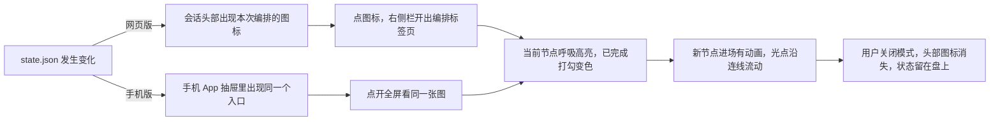

# 进度面板

从 state.json 变化到网页会话头部与手机抽屉两处入口显示当前节点

## 简报

### 目标
编排入口挂在当前会话的头部，点开在右侧栏看这一项的流程图；手机 App 里看同一张图。

### 要做什么
- 网页版由 Cordis 插件的客户端部分渲染，手机版是 dsh-go 原生小插件，两边读同一份 state.json。
- 网页入口是会话头部的「编排」图标按钮，只在会话所在项目开着编排时出现。点一下打开右侧栏的「编排」标签页，再点收起；右侧栏自带全屏，看大图用它。
- 面板按会话的项目目录读状态：同一项目下的会话看到同一份进度，别的项目互不相干。
- 标签页上方一行阶段与完成计数，下面下一步、选中图、项目，再下面是成员清单。
- 当前节点呼吸高亮，已完成节点打勾变色，新节点进场有动画，光点沿连线流动。
- 模式关闭后头部图标消失，已开着的标签页改显示「还没开启编排」，状态文件保留。

### 验收
- 敲 /orchestrate 后会话头部出现编排图标；点开右侧栏标签页能看到当前节点高亮；再点图标收起。
- 头部图标只出现在开了模式的项目里的会话；换个项目的会话就没有。
- 两个项目各开一份进度，面板各显示各的，不串。
- 手机 App 抽屉里能看到并点开同一张图。
- 关闭模式后头部图标消失，.orchestrate/state.json 仍在。

### 约束
- 面板只读状态文件，不自己写。
